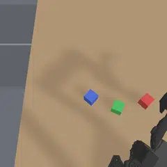

# so101-block-stack-eval

The SO-101 block stack in ManiSkill, as an [Inspect Robots](https://github.com/robocurve/inspect-robots) embodiment and task.

## Leaderboard

<!-- leaderboard:start -->

| # | Name | Provider | Stacked | Lifted | Cost | Calls | Tokens in | Tokens out | Minutes |
|--:|:--|:--|--:|--:|--:|--:|--:|--:|--:|
| 1 | claude-haiku-5-5 | anthropic | **34% (22%–48%)** | 86% | 0.020 | 38 | 523,773 | 10,333 | **1.3** |
| 2 | deepseek-v4.1-flash | deepseek | 30% (18%–42%) | **90%** | 0.082 | 62 | 723,514 | 76,012 | 8.2 |
| 3 | glm-5.3-flash | z-ai | 24% (12%–36%) | 70% | 0.039 | 50 | 475,919 | 7,002 | 2.1 |
| 4 | gpt-6-luna | openai | 16% (6%–26%) | 34% | **0.011** | **24** | **127,304** | **2,052** | 1.5 |
| 5 | nemotron-3.5-super-vl | nvidia | 0% (0%–0%) | 12% | 0.055 | 52 | 636,514 | 17,841 | 1.5 |

50 layouts, one trial each; 95% bootstrap interval over layouts. Cost in US dollars, calls, tokens and minutes waiting on the model are means per trial. Prompt version `8dd3b142780d`.

<!-- leaderboard:end -->

Each model on layout 42, "stack the red block on the green block", from the top camera:

| claude-haiku-5-5 | gpt-6-luna | deepseek-v4.1-flash | glm-5.3-flash | nemotron-3.5-super-vl |
|:-:|:-:|:-:|:-:|:-:|
|  |  |  |  |  |
| 459 steps | 83 steps | 185 steps | 82 steps | 74 steps |

The trials behind the table, with each run's actions, transcripts and model calls, are in the [Hugging Face dataset](https://huggingface.co/datasets/drwahl/so101-block-stack-eval).

## Task

`so101-block-stack` has one scene per layout in `src/so101_block_stack_eval/layouts.jsonl`. Each layout gives:
- the three blocks' positions and yaws;
- which block goes on which, and the instruction naming them;
- the arm's opening joint positions.

A trial succeeds on the first step the named block sits on its target, out of the jaws, with neither of the other blocks pushed out of place. A second scorer, `lifted`, records whether the jaws ever held the named block off the table.

`so101-block-stack-until-done` runs each trial until the agent calls `done` or `give_up`, or its steps run out. The last step repeats its command for a second, puts the arm pointing straight up without sweeping it through the blocks, and waits another second. `standing` records whether the named block was out of the jaws on its target before the arm moved, and still is, with neither other block pushed out of place and no part of the arm touching the stack; `stacked` records whether the stack ever held as the default task scores it. The leaderboard counts this task, with `standing` as Stacked.

## Embodiment

`so101_sim` is one ManiSkill environment with physics on the CPU. Each action is an absolute pose for the grip point: x, y and z in the arm's base frame, the wrist's yaw, the tool's pitch below level, and the jaw opening. The grip point is where a block's centre sits once the jaws close on it. A closed-form IK turns each pose into joint targets. A target the arm cannot reach, or one that would turn a joint too far in one step, is refused and the arm holds its last target. Observations are the wrist and overhead camera images, the commanded pose read back from the arm, and the joint positions.

## Running an agent

```
uv sync
export OPENROUTER_API_KEY=...  # or ANTHROPIC_API_KEY for anthropic/claude-* models
uv run python scripts/run.py z-ai/glm-5.3-flash --until-done
```

`scripts/run.py` passes the agent two things the `inspect-robots run` CLI cannot: `SimEmbodiment.pre_check`, which gives the reason a motion would be refused, and `LOCATE_POINTS`, a custom tool that maps top-camera pixels to base-frame points on a horizontal plane. Every model runs at low reasoning effort, through OpenRouter, except Anthropic's, which go to Anthropic's Messages API under the names Anthropic gives them (`anthropic/claude-haiku-5-5`).

Only the cameras render on the GPU. To run without one, hide it and render with Mesa's software Vulkan:

```
CUDA_VISIBLE_DEVICES= VK_ICD_FILENAMES=/usr/share/vulkan/icd.d/lvp_icd.json \
    uv run python scripts/run.py z-ai/glm-5.3-flash --until-done
```

The agent plugin's custom tools are not released yet, so `inspect-robots-agent` and `inspect-robots` come from the `agent-custom-tools` branch of [a fork](https://github.com/danwahl/inspect-robots); `uv.lock` records the commit.

## Tests

```
uv run pytest
```

## License

Apache 2.0. The arm's description in `src/so101_block_stack_eval/description/` is adapted from the SO-101 in [TheRobotStudio's SO-ARM100](https://github.com/TheRobotStudio/SO-ARM100), under the same license.
